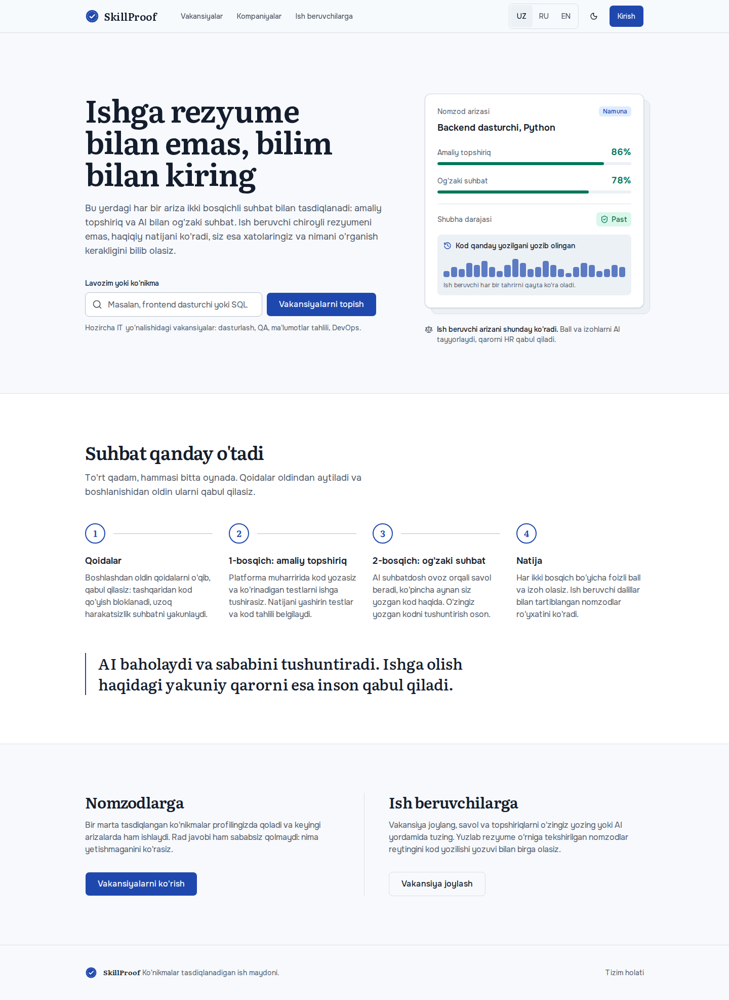
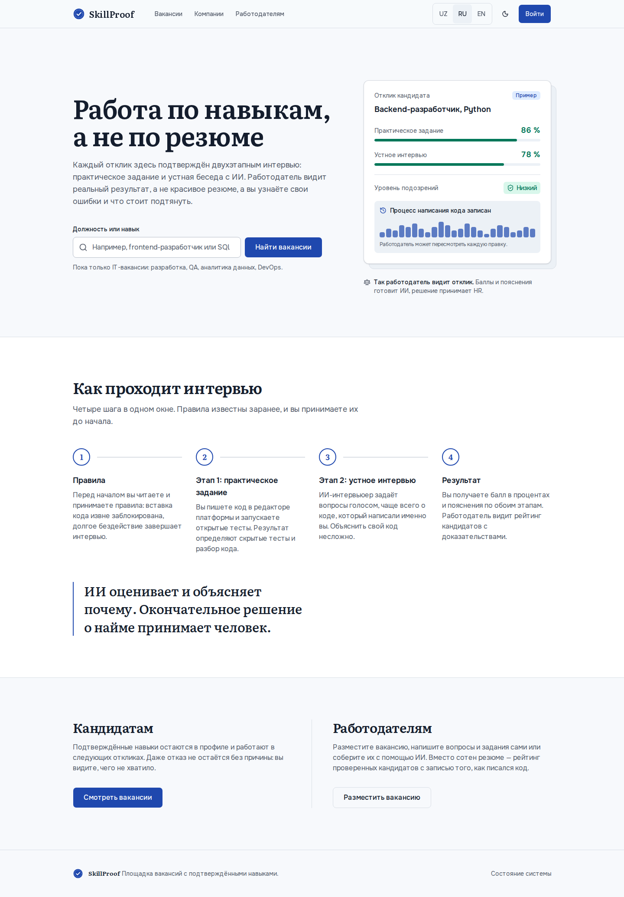
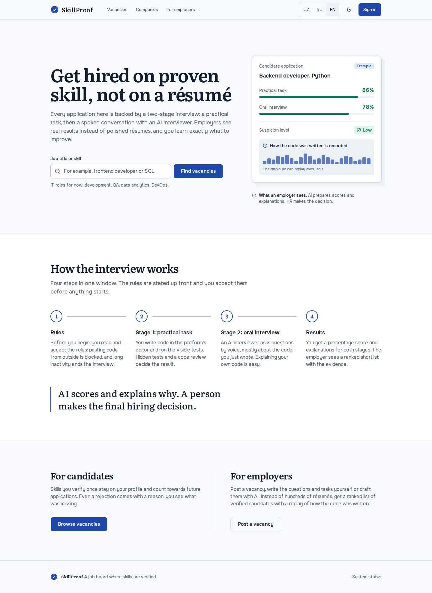
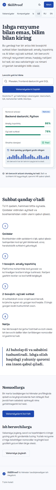
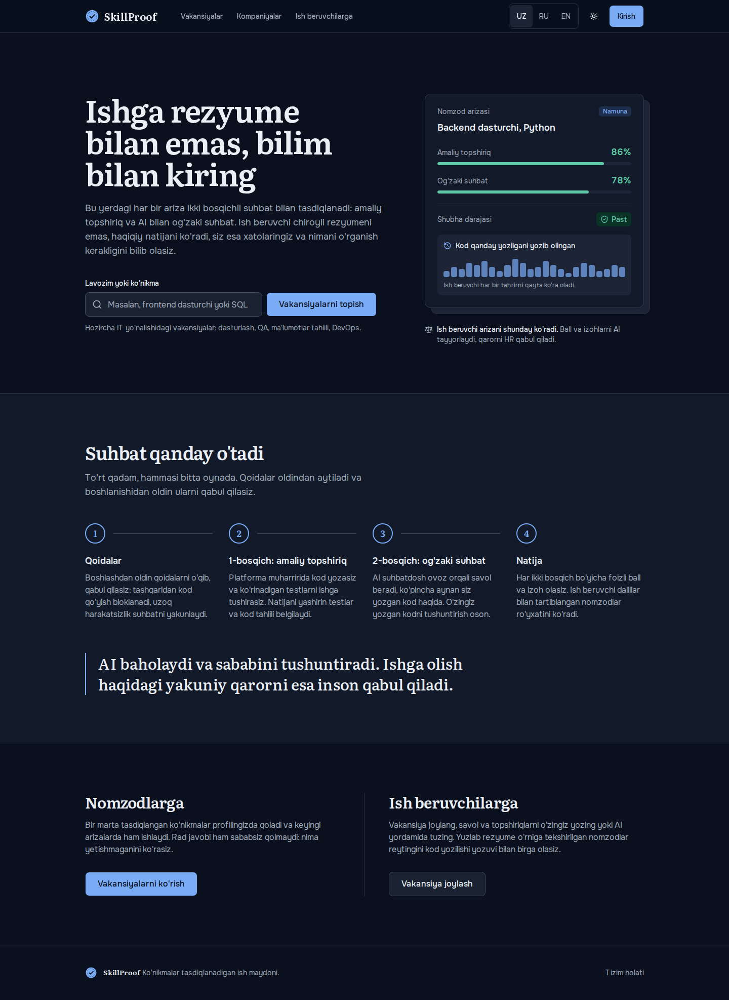
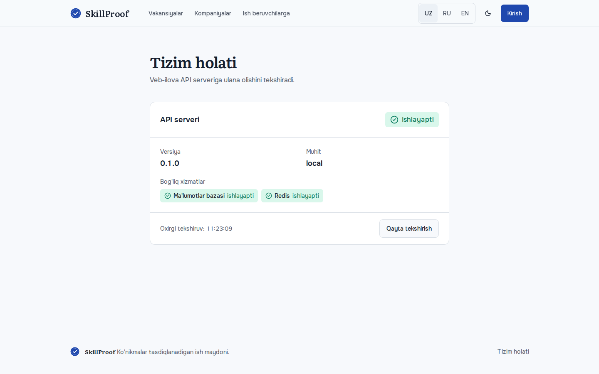

# Phase 0 hisoboti: loyiha skeleti

**Sana:** 2026-10-30 · **Holat:** qabul shartlari bajarildi ✅

## Qabul shartlari (spec §10, Phase 0)
| Shart | Natija |
|---|---|
| `make up` hammasini ishga tushiradi | ✅ api, worker, web, postgres, redis — hammasi `healthy` |
| `/health` OK | ✅ `{"status":"ok","checks":{"database":"ok","redis":"ok"}}` (to'g'ridan va web proxy orqali) |
| Frontend 3 tilda ochiladi | ✅ `/uz`, `/ru`, `/en` → 200; `/` → `/uz` |
| CI yashil | ✅ lokalda CI qadamlari bajarildi (GitHub'ga hali push qilinmagan) |

## Nima qilindi
**Backend** (`/backend`, Python 3.12, uv)
- FastAPI app factory, `/health` (DB + Redis tekshiruvi, nosozlikda 503).
- Sozlamalar (`pydantic-settings`) va **threshold registry** (`app/core/thresholds.py`): spec'dagi barcha chegaralar (paste 2 qator/80 belgi, inactivity 60/90 s, Stage 1 pass 70%, vaznlar 70/30, shubha 30/70%, retention 180 kun …). Global qiymat env orqali, per-assessment override chuqur birlashtiriladi va qayta validatsiya qilinadi.
- Async SQLAlchemy, Alembic (baseline migratsiya), JSON log + `X-Request-ID`, yagona xato formati.
- AI: `llm_client.py` (mock standart; sxema validatsiyasi → 1 marta qayta urinish → `needs_review`; har chaqiruv log qilinadi), `speech.py` (mock STT/TTS), `prompts/_base_rules.md` (spec §6.6 dagi 10 qoida).
- arq worker.

**Frontend** (`/frontend`, frontend-dev agenti bajardi)
- Next.js 16 (App Router), TypeScript strict, Tailwind v4, shadcn/ui, next-intl (uz/ru/en), TanStack Query, openapi-fetch (turlar haqiqiy API'dan generatsiya qilingan).
- Header (til almashtirgich, light/dark), footer, bosh sahifa, `/status` sahifasi, lokalizatsiya qilingan 404/xato sahifalari.
- Dizayn: "Lapis & paper" (D-015).

**Infra:** `docker-compose.yml`, `Makefile`, `.env.example`, GitHub Actions CI, `docs/*`.

**Agent:** `.claude/agents/frontend-dev.md` + no-code-mvp'dan moslashtirilgan 6 skill: frontend-design, design-system, ui-motion, react-architecture, i18n, frontend-quality.

## Testlar va tekshiruvlar
| | Natija |
|---|---|
| Backend pytest | 18/18 ✅ (health, xato formati, thresholds, mock LLM/STT/TTS, retry/needs_review) |
| ruff + mypy (strict) | toza ✅ |
| Frontend vitest | 15/15 ✅ (i18n kalitlari mosligi, API klient, status sahifasi holatlari) |
| Playwright e2e + axe | 14/14 ✅, critical/serious a11y xato 0 |
| eslint + tsc + next build | toza ✅ |

## Skrinshotlar
| | |
|---|---|
| Bosh sahifa — uz |  |
| Bosh sahifa — ru |  |
| Bosh sahifa — en |  |
| Telefon (390px) |  |
| Dark mode |  |
| Tizim holati (jonli API) |  |

## Qanday ishga tushiriladi
```bash
cp .env.example .env
make up                       # web: http://localhost:3000  api: http://localhost:8000/docs
make test && make lint
make screenshots
```

## Qo'lda tekshirish uchun
1. http://localhost:3000 → `/uz` ga o'tadi; UZ/RU/EN almashtirgich sahifani saqlab tilni o'zgartiradi.
2. Oy belgisi — dark mode.
3. Footer → "Tizim holati": API, DB, Redis yashil. `docker compose stop api` qilsangiz "ishlamayapti" holati chiqadi.

## O'zgarishlar va ochiq savollar
1. **MinIO olib tashlandi** (sizning qaroringiz). Fayllar hozircha lokal diskda, S3 keyinroq env orqali ulanadi (D-004).
2. **Lokal `hr_db`:** `backend/.env` ga yozildi, lekin WSL'dan Windows'dagi Postgres'ga ulanib bo'lmadi (timeout). `.wslconfig` da `networkingMode=mirrored` kerak (yoki Postgres'ni tarmoqqa ochish). Shuning uchun `make up` hozir compose'ning o'z postgres'ida tekshirildi.
3. **JS hajmi:** ochiq sahifalar ~193 KB gzip, skill byudjeti 150 KB. ~135 KB'i React + Next runtime'ining o'zi. Byudjetni ~200 KB ga ko'tarishni taklif qilaman.
4. Telefonda nav qatori gorizontal scroll bo'ladi ("Ish beruvchilarga" chetda kesilib ko'rinadi). Phase 2'da nav to'liq bo'lganda qayta ko'rib chiqiladi.
5. Playwright uchun tizimda `libnss3`, `libnspr4`, `libasound2t64` yo'q, vaqtincha yechim ishlatildi. Doimiy yechim: `sudo pnpm exec playwright install-deps chromium`.
6. Header'dagi havolalar (Vakansiyalar, Kirish …) hozircha 404 ga olib boradi; ular Phase 1–2'da quriladi.
