# Phase 1 hisoboti: auth, foydalanuvchilar, kompaniyalar

**Sana:** 2026-10-30 · **Holat:** qabul shartlari bajarildi ✅

## Qabul shartlari (spec §10, Phase 1)
| Shart | Natija |
|---|---|
| Nomzod va HR rollari ishlaydi | ✅ API testlari, frontend testlari va jonli stack'da qo'lda tekshirildi |
| A kompaniya HR'i B kompaniyaga kira olmaydi | ✅ `test_hr_of_company_a_cannot_access_company_b`: 7 ta endpoint, hammasi `404 not_found` |

## Backend
**Auth**
- Ro'yxatdan o'tish (nomzod yoki ish beruvchi), login, logout, `me` va uni tahrirlash.
- Tokenlar faqat httpOnly cookie'da: `sp_access` (15 daqiqa), `sp_refresh` (30 kun). Refresh har safar almashadi; eski token qayta ishlatilsa, foydalanuvchining barcha sessiyalari bekor qilinadi.
- Email tasdiqlash va parolni tiklash. Xatlar hozircha log'ga yoziladi (console backend), shablonlar uz/ru/en tillarida.
- Rate limit: login, ro'yxatdan o'tish, parol tiklash.
- `forgot-password` har doim `202` qaytaradi, shuning uchun email ro'yxatda bor-yo'qligi oshkor bo'lmaydi.

**Nomzod profili**
- Sarlavha, mamlakat (ISO), shahar, tajriba, "o'zim haqimda", kutilayotgan maosh (butun son, UZS standart), "ish qidiryapman".
- Rezyume: PDF/DOC/DOCX, 5 MB gacha. Turi kengaytmadan emas, fayl tarkibidan (magic bytes) tekshiriladi. Yuklab olish va o'chirish mumkin.

**Kompaniyalar**
- Faqat HR akkaunti kompaniya yarata oladi va yaratgan kishi owner bo'ladi. Slug avtomatik yasaladi; o'zbekcha tutuq belgisi to'g'ri ishlanadi: "O'zbek Soft" → `ozbek-soft`.
- Ochiq sahifa slug orqali; tahrirlash; logo yuklash (PNG/JPEG/WEBP, 2 MB, SVG rad etiladi).
- Jamoa: a'zolar ro'yxati, owner a'zoni o'chiradi (oxirgi owner o'chirilmaydi).
- Takliflar: owner email bo'yicha taklif yuboradi (7 kun amal qiladi) va bekor qila oladi. Taklifni faqat o'sha emaildagi HR akkaunti qabul qiladi.
- Kirish qoidasi: begona kompaniya → `404` (mavjudligi ham oshkor bo'lmaydi); oddiy HR owner amalini bajarsa → `403`.

**Ma'lumotlar modeli:** `users`, `auth_tokens`, `companies`, `company_members`, `company_invitations`, `candidate_profiles`, `audit_log`. Migratsiya yuqoriga va pastga sinaldi. Qarorlar: `docs/DECISIONS.md` D-022…D-029.

## Frontend (frontend-dev agenti)
**Sahifalar**
- Kirish, ro'yxatdan o'tish (nomzod yoki ish beruvchi, ikkita tanlov kartasi), email tasdiqlash, parolni tiklash, sozlamalar (ism, til, vaqt zonasi).
- Nomzod: "Mening rezyumem" — profil formasi va rezyume fayli (yuklash, yuklab olish, o'chirish; fayl avval brauzerda tekshiriladi).
- HR: kompaniya yaratish, kompaniya profili va logo, jamoa (a'zolar, taklif yuborish, kutilayotgan takliflar, bekor qilish). Bir nechta kompaniya bo'lsa — kompaniya almashtirgich.
- Taklif sahifasi: kirmagan foydalanuvchi, noto'g'ri email, noto'g'ri rol, qabul qilish, muddati o'tgan yoki bekor qilingan holatlar.

**Sessiya**
- 401 kelsa: bitta umumiy refresh so'rovi yuboriladi, keyin asl so'rov qayta yuboriladi; refresh ham o'xshamasa — login sahifasiga.
- Email tasdiqlanmagan bo'lsa banner chiqadi ("Xatni qayta yuborish").
- Noto'g'ri rol uchun 403 sahifasi.

**hh.uz tuzilmasi** (sizning UX talabingiz; brend, rang va ikonkalar o'zimizniki)
- Header: logo · "Kasb, lavozim yoki kompaniya" qidiruvi + hudud tanlash + "Qidirish" · "Vakansiya joylash" · kirish yoki avatar menyusi.
- Avatar menyusi:
  - nomzod: Rezyumelarim, Arizalarim, Saqlanganlar, Natijalarim, Sozlamalar;
  - HR: Vakansiyalarim, Nomzodlar, Kompaniya, Jamoa, Sozlamalar.
- Telefonda: logo + qidiruv ikonkasi va pastki panel (Qidiruv, Saqlanganlar, Arizalar, Profil).
- Bosh sahifa: katta qidiruv va tezkor filtrlar (Masofaviy, Tajribasiz, Yarim stavka, IT, Stajirovka).
- Hali qurilmagan bo'limlar (vakansiyalar, arizalar, saqlanganlar…) "tez orada" sahifasini ko'rsatadi; ular Phase 2+ da quriladi. Qidiruv hozircha `/vacancies?q=&region=` ga oddiy GET forma, autosuggest manbasi bo'sh — Phase 2 da API'ga bir joyda ulanadi.

## Testlar
| | Natija |
|---|---|
| Backend pytest | **46/46** ✅ (auth 13, nomzod 6, kompaniyalar 9, Phase 0 dagilar 18) |
| ruff + mypy strict | toza ✅ |
| Jonli stack (web proxy orqali) | register → refresh → kompaniya yaratish ✅ |
| Frontend vitest | **70/70** ✅ (refresh-on-401, login/ro'yxatdan o'tish formalari, rezyume tekshiruvi, jamoa sahifasi: owner va oddiy HR, i18n kalitlari) |
| Playwright e2e + axe | **18/18** desktop, **7/7** mobil ✅ |
| eslint + tsc + next build | toza ✅ |
| Taklifni oxirigacha qabul qilish (jonli) | owner taklif yubordi → HR shu email bilan ro'yxatdan o'tdi → qabul qildi → jamoada `hr` sifatida paydo bo'ldi ✅ |

## Skrinshotlar (jonli stack'dan, `make up` + haqiqiy API)
| | |
|---|---|
| Kirish | 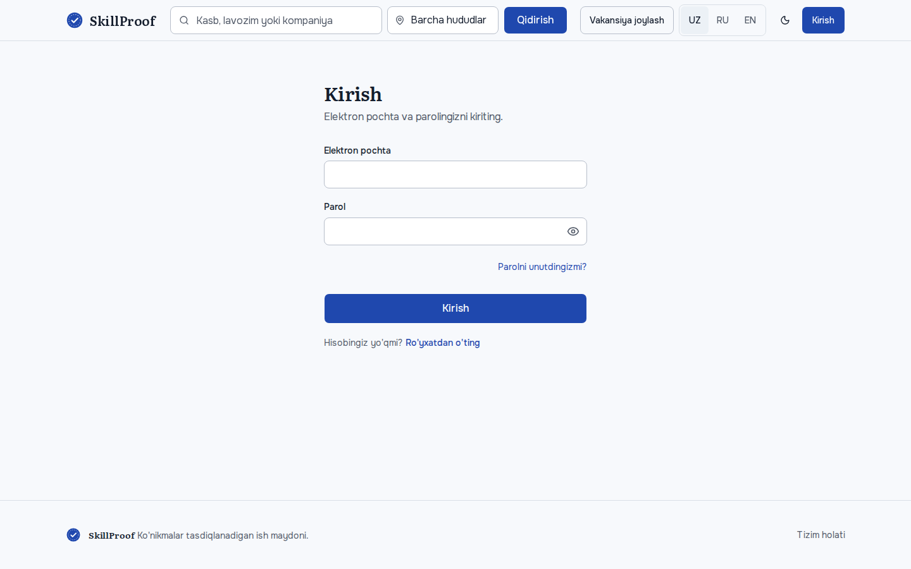 |
| Ro'yxatdan o'tish: rol tanlash | 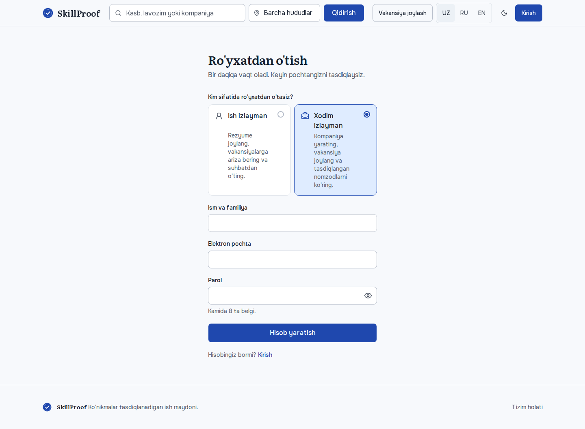 |
| Nomzod profili + rezyume | 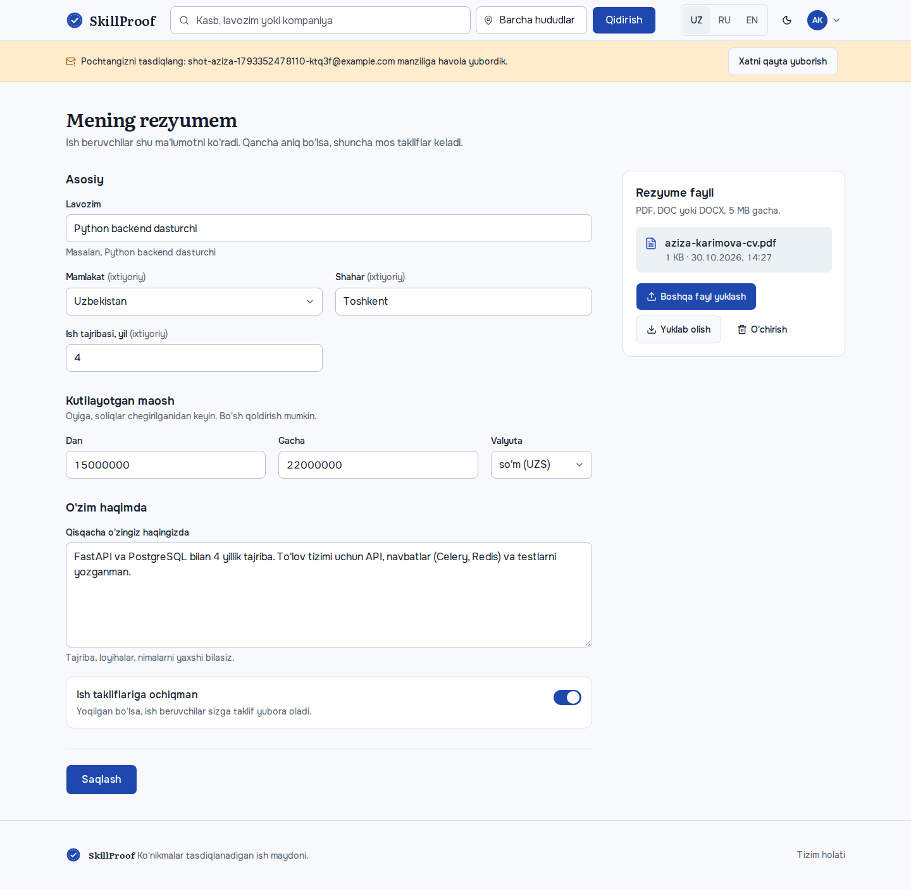 |
| HR: kompaniya yaratish | 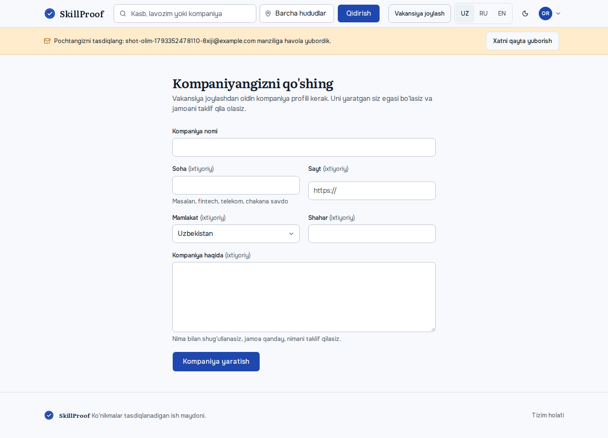 |
| HR: kompaniya profili | 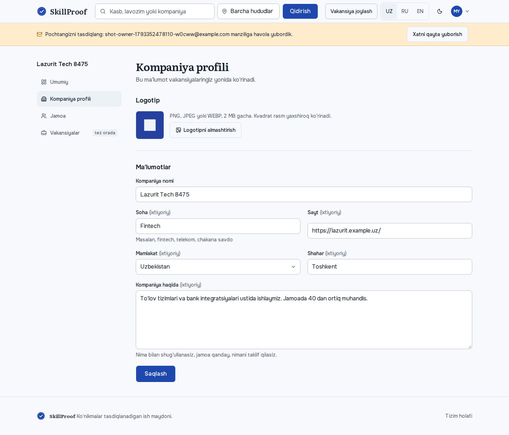 |
| HR: jamoa va takliflar | 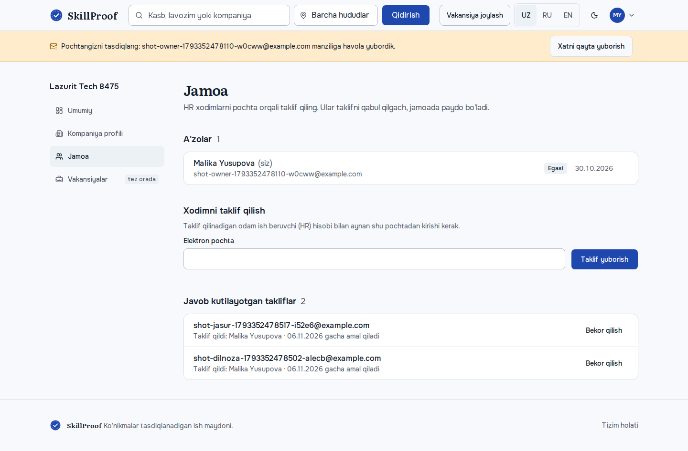 |
| Taklif sahifasi | 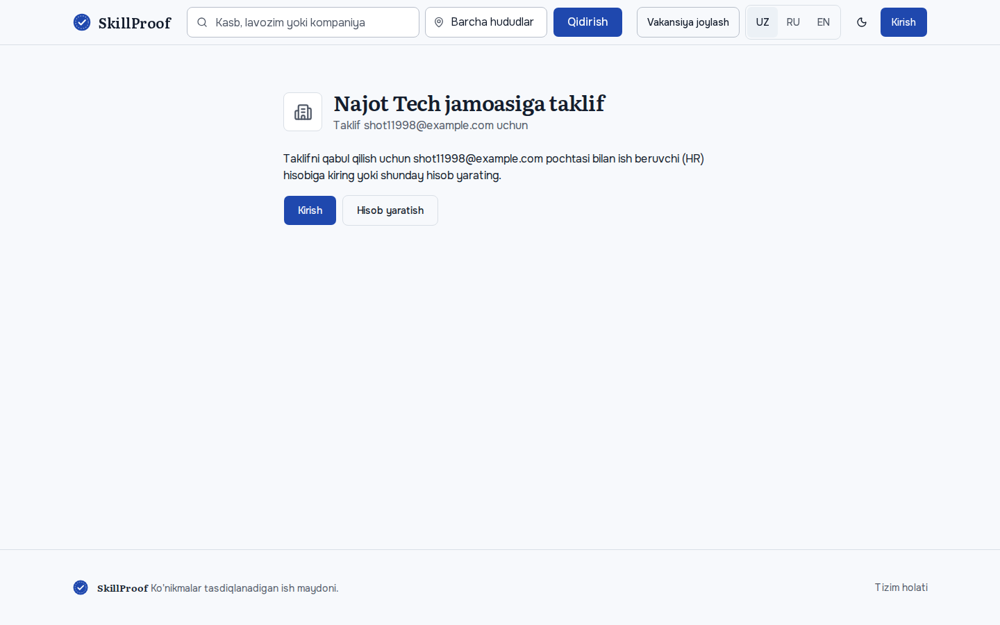 |
| Bosh sahifa (hh.uz tuzilmasi) | 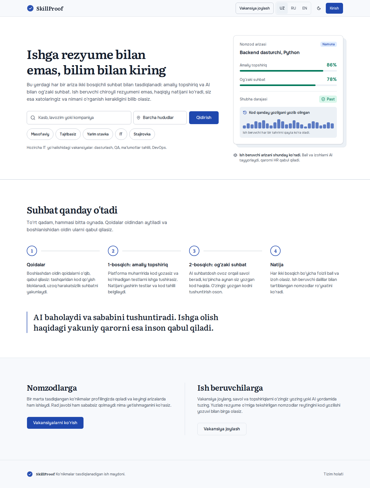 |
| Header qidiruvi + nomzod menyusi | 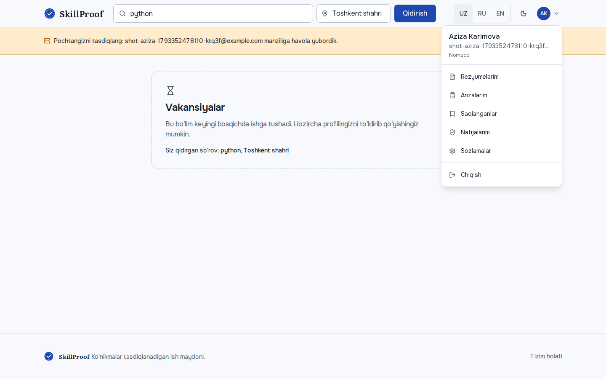 |
| Kirish — telefon | 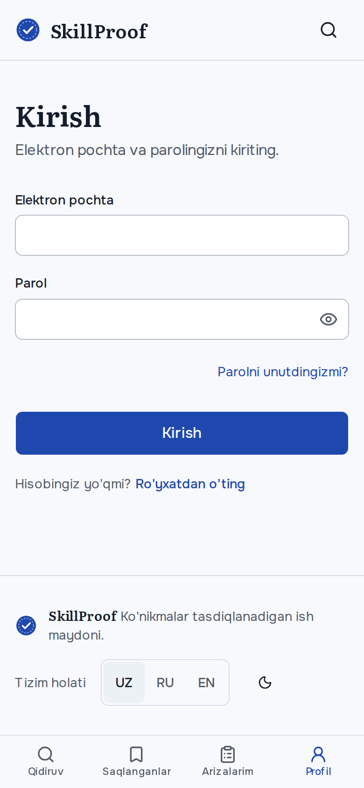 |
| Bosh sahifa — telefon | 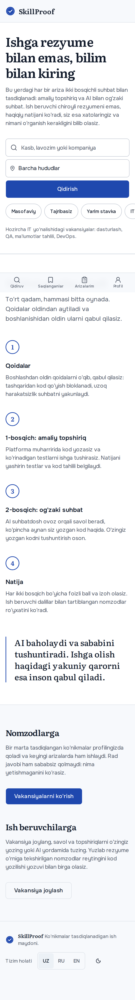 |
| Nomzod profili — telefon, dark | 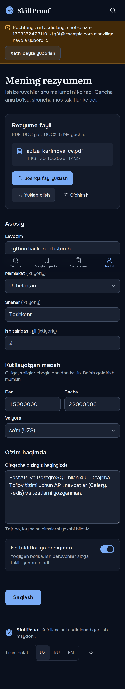 |

Izoh: telefon skrinshotlari butun sahifani bitta rasmga oladi, shuning uchun pastki panel (ekran pastiga mahkamlangan) rasmda sahifa o'rtasida ko'rinadi. Haqiqiy telefonda u doim pastda turadi.

## Qanday ishga tushiriladi
```bash
make up                       # http://localhost:3000/uz
make test && make lint
INVITE_TOKEN=<docker compose logs api dagi taklif tokeni> PHASE=1 make screenshots
```
Email xatlari (tasdiqlash, parol, taklif) hozircha `docker compose logs api` da ko'rinadi: `email_sent` qatoridagi havola.

## Qo'lda tekshirish uchun
1. `/uz/register` → "Ish beruvchi" → kompaniya yarating → "Jamoa" → hamkasbingiz emailiga taklif yuboring.
2. Log'dan taklif havolasini oching, o'sha email bilan HR sifatida ro'yxatdan o'tib, taklifni qabul qiling.
3. Ikkinchi brauzerda nomzod sifatida ro'yxatdan o'ting → "Rezyumelarim" → profilni to'ldirib, PDF yuklang.
4. Telefon kengligida (360px) pastki panel va qidiruv ikonkasini tekshiring.

## Ochiq savollar
1. `hr_db` WSL'dan hali ko'rinmaydi, ish compose postgres'da (Phase 0 hisobotiga qarang).
2. Tasdiqlanmagan email hozircha hech narsani bloklamaydi. Phase 2 da ariza berish uchun tasdiqlash shart qilinsinmi?
3. hh.uz uslubidagi UX bo'yicha xabaringiz 2-bandda uzilib qolgan. Phase 2 (job board) uchun davomi kerak.
4. Phase 2 uchun kerakli API (frontend agenti so'radi): qidiruv autosuggest, hududlar ro'yxati, saqlangan vakansiyalar, vakansiya ro'yxati filtrlari (`q`, `region`, `remote_type`, `experience_level`, `employment_type`, `profession_area`).
5. Taklif sahifasini e2e'da avtomatik tekshirish uchun faqat lokal muhitda ishlaydigan "outbox" endpoint qo'shilsinmi? Hozir token log'dan olinadi.
6. Route himoyasi faqat brauzerda ishlaydi (D-017). Server tomonda tez redirect qilish uchun maxfiy bo'lmagan `sp_session=1` cookie qo'shish mumkin; zarur emas, lekin sahifa ochilganda qisqa "yuklanmoqda" holatini yo'qotadi.
