# Phase 2 hisoboti: job board (hh.uz tuzilmasida)

**Sana:** 2026-10-30 · **Holat:** qabul shartlari bajarildi ✅

## Qabul shartlari (spec §10, Phase 2)
| Shart | Natija |
|---|---|
| Guest vakansiyani topadi | ✅ API + UI (e2e test va jonli stack) |
| Nomzod ariza beradi | ✅ API + UI (e2e test va jonli stack) |
| HR arizani ko'radi | ✅ API + UI (e2e test va jonli stack) |
| Qidiruv 10k vakansiyada < 300 ms (spec §9) | ✅ eng sekin so'rov p95 = **44 ms** (10 055 vakansiya, facet'lar bilan) |

## Backend
**Ma'lumotnomalar** (kodda emas, bazada — spec §1.1)
- 14 hudud (uz/ru/en nomlari bilan), 6 kasb sohasi, 60 ta IT ko'nikma.
- Migratsiya ularni avtomatik yuklaydi.

**Vakansiyalar**
- HR yaratadi, tahrirlaydi va nashr qiladi. Holatlar: qoralama → nashr → yopilgan → arxiv.
- Ko'nikmalar vazni (1–5) va "majburiy" belgisi bilan.
- Nashr qilish uchun tavsif shart. O'chirish faqat qoralamada mumkin.
- Yopilgan vakansiya havola orqali ochiladi, lekin qidiruvda chiqmaydi.

**Qidiruv (hh.uz kabi)**
- To'liq matnli qidiruv: lavozim, ko'nikmalar, talablar, tavsif va kompaniya nomi bo'yicha. Prefiks bo'yicha ishlaydi ("pyth" → Python).
- Filtrlar: hudud, ish formati, bandlik turi, tajriba, kasb sohasi, ko'nikma, maosh "dan" + valyuta, "faqat maosh ko'rsatilganlar", kompaniya.
- Saralash: moslik, sana, maosh (kamayish va o'sish bo'yicha).
- Har filtr qiymati yonida sanoq (facet). Bir filtrni tanlaganda shu filtrning boshqa variantlari sanog'i yo'qolmaydi, xuddi hh.uz dagidek.
- Autosuggest: vakansiya nomlari, ko'nikmalar, kompaniyalar.

**Nomzod**
- Ariza berish (ixtiyoriy xat bilan), qaytarib olish, qaytadan topshirish.
- "Arizalarim" va "Saqlanganlar".
- Vakansiya kartochkasida nomzodning holati ko'rinadi: saqlangan, ariza yuborilgan.

**HR**
- "Vakansiyalarim": arizalar soni va "+N yangi" belgisi.
- "Nomzodlar": profil ma'lumotlari va xat, "tanlash" yoki "rad etish", rezyumeni yuklab olish. Har bir yuklab olish audit log'ga yoziladi.
- Boshqa kompaniya HR'i hech narsani ko'rmaydi (404).

**Demo ma'lumotlar** (`make seed`, faqat lokal): 8 kompaniya, 55 vakansiya, demo akkauntlar.
- HR: `demo.hr@example.com`
- Nomzod: `demo.candidate@example.com`
- Parol: `Demo-parol-2026`

Qarorlar: `docs/DECISIONS.md` D-050…D-057.

## Frontend (frontend-dev agenti)
**Ochiq sahifalar**
- `/vacancies` (hh.uz tuzilmasi): chapda filtrlar va sanoqlar; tepada saralash, olib tashlanadigan filtr chiplari va "tozalash"; pastda raqamli sahifalash.
- Telefonda "Filtrlar (n)" tugmasi to'liq ekranli oynani ochadi, pastida "N ta vakansiyani ko'rsatish".
- Birinchi sahifa serverda tayyorlanadi (SEO uchun), filtrlar faqat URL'da saqlanadi — havolani ulashish mumkin.
- Vakansiya sahifasi: maosh, shartlar, ko'nikmalar (majburiylari ajratib ko'rsatilgan), tavsif. O'ng tomonda kompaniya kartochkasi va ariza bloki, telefonda pastga mahkamlangan ariza paneli. Pastda o'xshash vakansiyalar.
- Ariza oynasi: ixtiyoriy xat va 2 bosqichli suhbat haqida izoh. Mehmon login sahifasiga yo'naltiriladi, kirgandan keyin oyna o'zi ochiladi.
- Kompaniya sahifasi va uning vakansiyalari.
- Header'dagi autosuggest va hududlar haqiqiy API'ga ulandi; bosh sahifada "Yangi vakansiyalar" bloki.

**Nomzod**
- "Arizalarim": holat tablari va qaytarib olish.
- "Saqlanganlar": yurakcha bosilganda darhol o'zgaradi, xato bo'lsa orqaga qaytadi.

**HR**
- "Vakansiyalarim": tablar (Faol, Qoralama, Yopilgan, Arxiv) sanoqlari bilan, "+N yangi" belgisi; nashr qilish, yopish, qayta ochish, arxivlash, tahrirlash.
- Vakansiya formasi: ko'nikmalar, ularning vazni (1–5) va "majburiy" belgisi.
- "Nomzodlar": vakansiya bo'yicha filtr, tanlash yoki rad etish, rezyumeni yuklab olish.
- Phase 7 dagi ballar uchun joy belgilab qo'yilgan; hozir u yerda soxta raqam yo'q.

**Test paytida topilib tuzatilgan xatolar**
- Server va brauzer render'i mos kelmasligi (React #418).
- Ariza oynasi muvaffaqiyat xabarini ko'rsatmay yopilib qolishi.
- Demo akkauntlar login qila olmasligi: `.local` domeni validatsiyadan o'tmaydi, `example.com` ga o'tkazildi.
- HR tablari uchun 4 ta ortiqcha so'rov: `counts_by_status` bilan bittaga tushirildi.

Qarorlar: D-030…D-037 (frontend), D-050…D-057 (backend).

## Testlar
| | Natija |
|---|---|
| Backend pytest | **58/58** ✅ (Phase 2: 12 ta yangi test — hayot sikli, ko'rinish, validatsiya, qidiruv/filtr/facet/saralash, xavfli qidiruv matni, suggest, ariza, saqlanganlar, HR oqimi va kompaniyalar izolyatsiyasi) |
| ruff + mypy strict | toza ✅ |
| `make bench-search` | 10 055 vakansiya: median 19–35 ms, p95 ≤ 44 ms ✅ |
| Frontend vitest | **101/101** ✅ |
| Playwright e2e + axe | **28/28** ✅ (21 desktop + 7 mobil) |
| eslint + tsc + next build | toza ✅ |

## Skrinshotlar
Jonli stack'dan, demo akkauntlar bilan.

| | |
|---|---|
| Vakansiyalar + filtrlar | 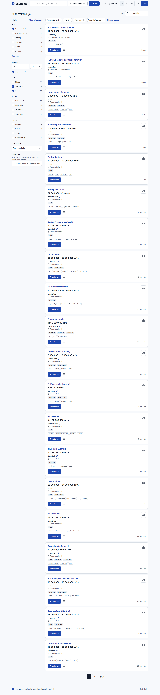 |
| Vakansiyalar — telefon | 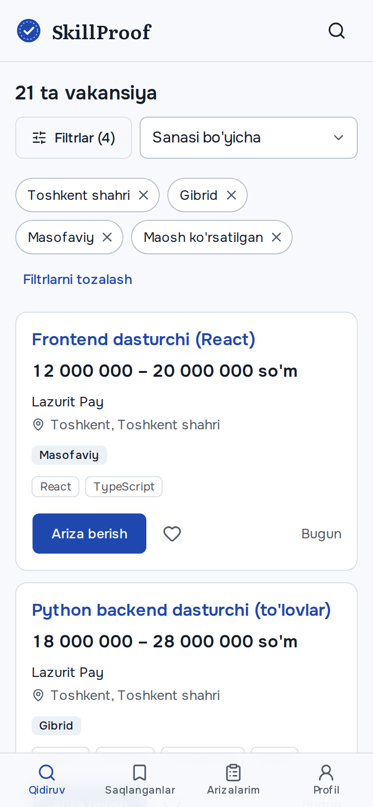 |
| Filtr oynasi — telefon | 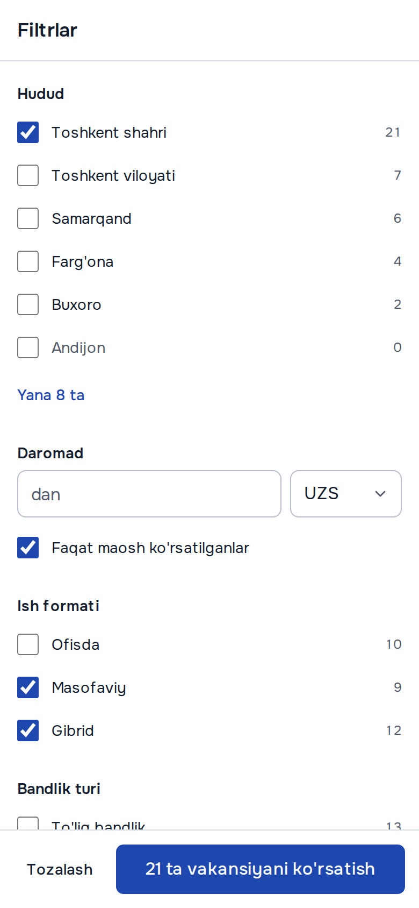 |
| Vakansiya sahifasi | 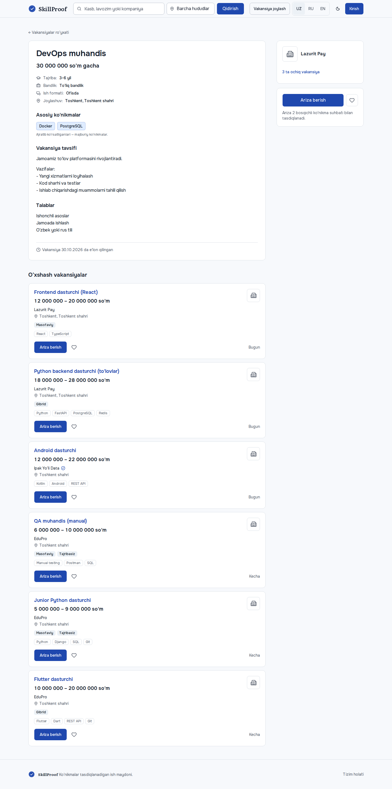 |
| Vakansiya — telefon | 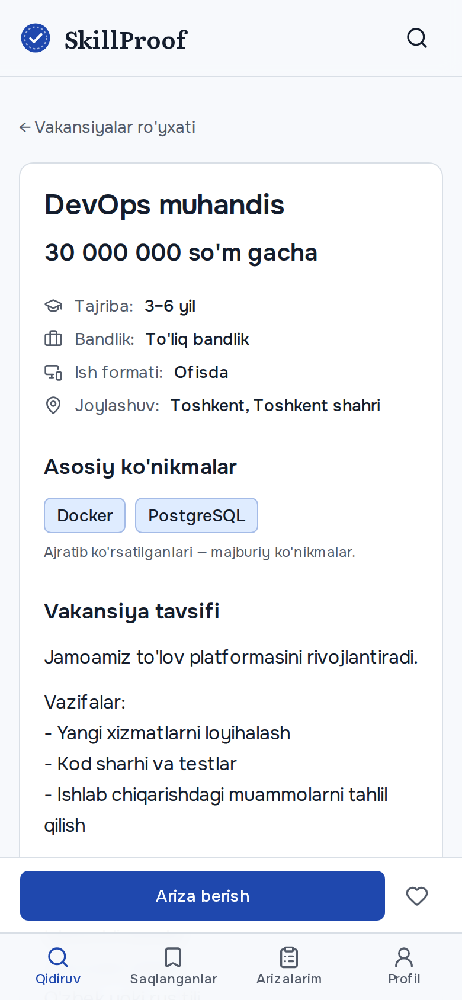 |
| Ariza oynasi | 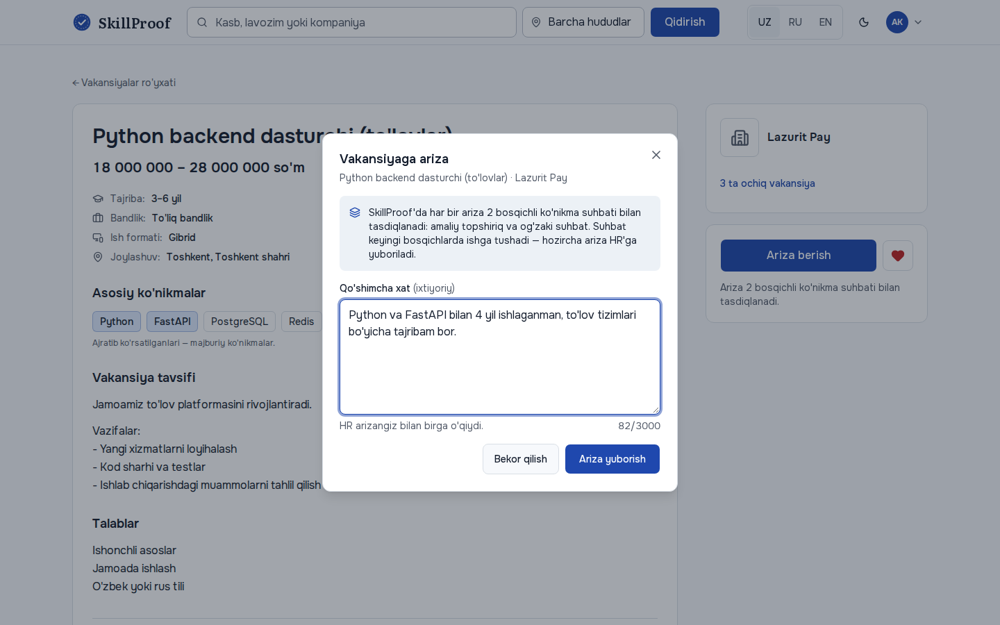 |
| Kompaniya sahifasi | 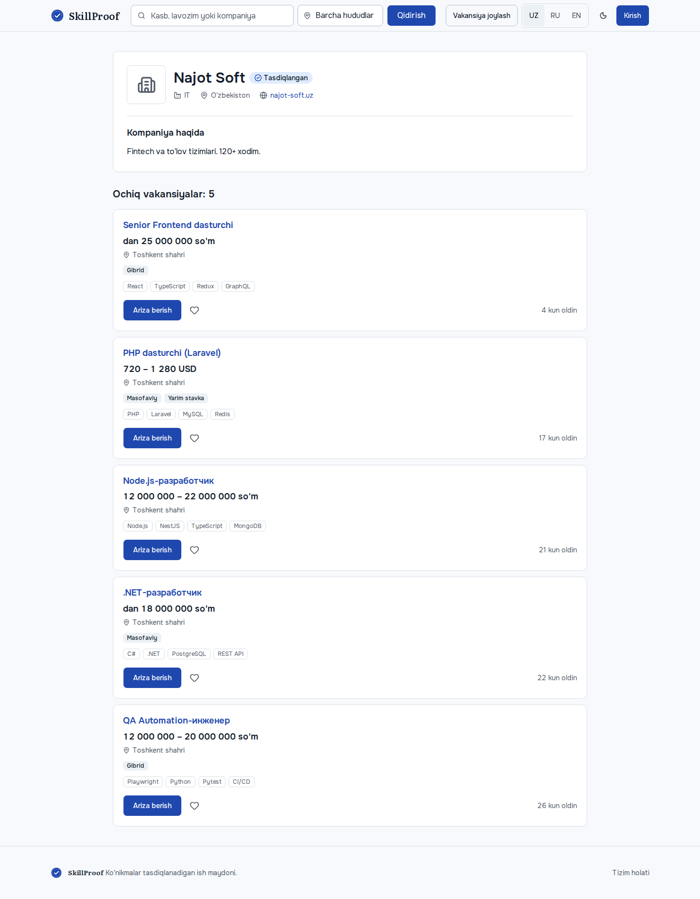 |
| Arizalarim | 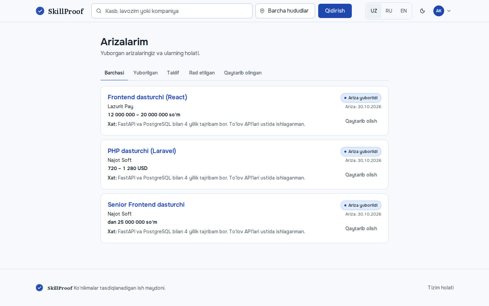 |
| Saqlanganlar | 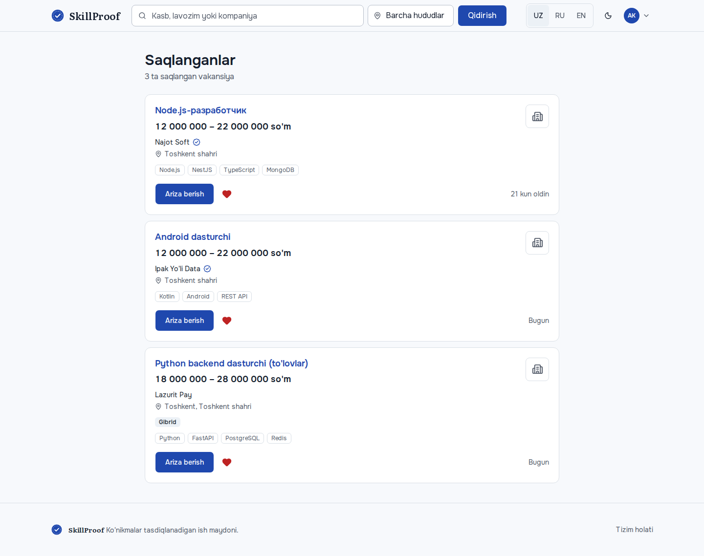 |
| HR: Vakansiyalarim | 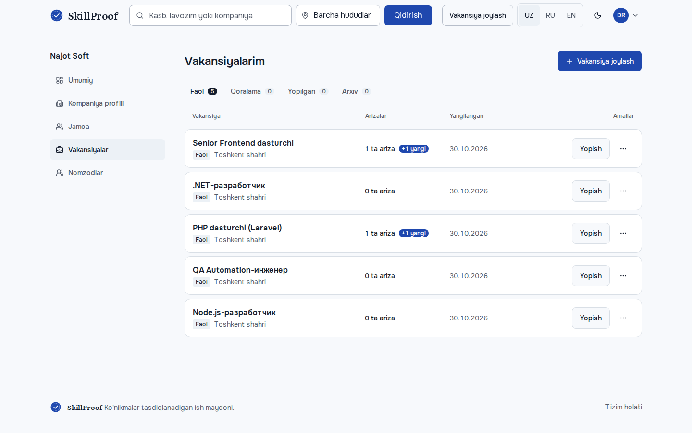 |
| HR: vakansiya formasi | 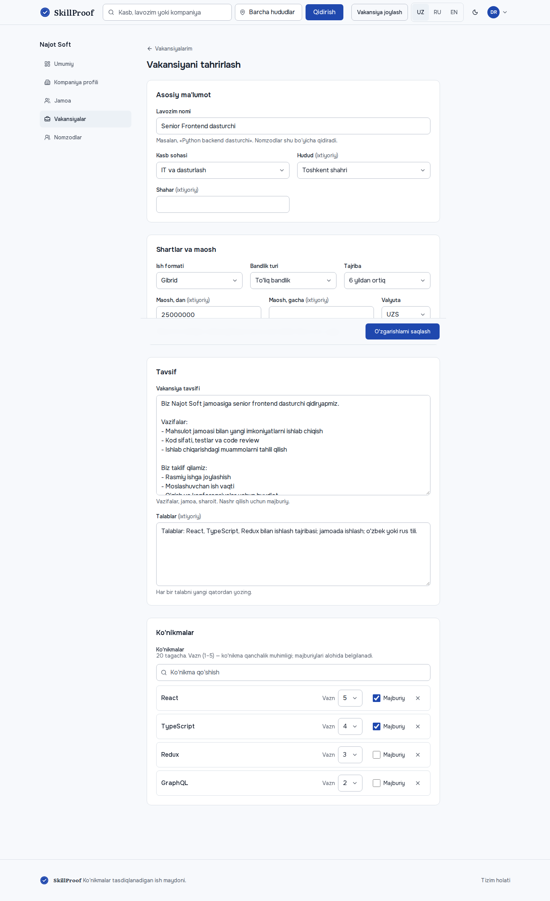 |
| HR: Nomzodlar | 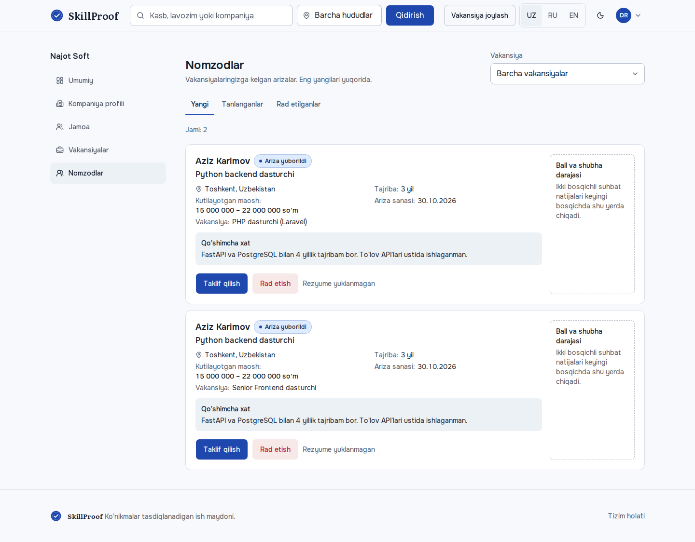 |
| Bosh sahifa: yangi vakansiyalar | 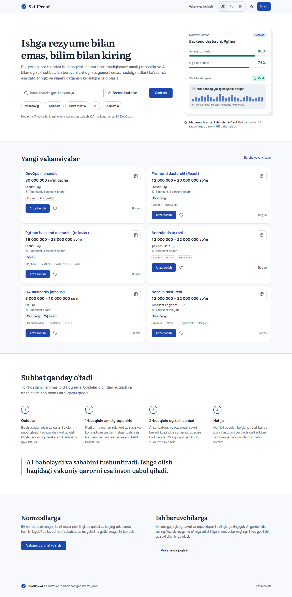 |
| Qidiruv — ruscha | 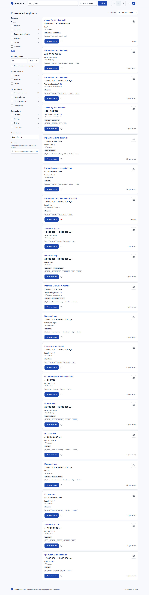 |

## Qo'lda tekshirish
`make up && make seed`, keyin http://localhost:3000/uz/vacancies. Demo akkauntlar: `demo.candidate@example.com` va `demo.hr@example.com`, parol `Demo-parol-2026`.

## Ochiq savollar
1. hh.uz bo'yicha xabaringizning davomi kelmadi. Qolgan sahifalar (ro'yxat, vakansiya, kompaniya, arizalar, HR) hh.uz ning ma'lum andozalari bo'yicha qurilmoqda.
2. HR qoralama vakansiyani ochiq sahifa ko'rinishida oldindan ko'rishi kerakmi? Hozir faqat tahrirlash mumkin.
3. Ariza berish uchun email tasdiqlash hozircha shart emas. Kerak bo'lsa, `REQUIRE_VERIFIED_EMAIL_TO_APPLY=true` bilan yoqiladi.
